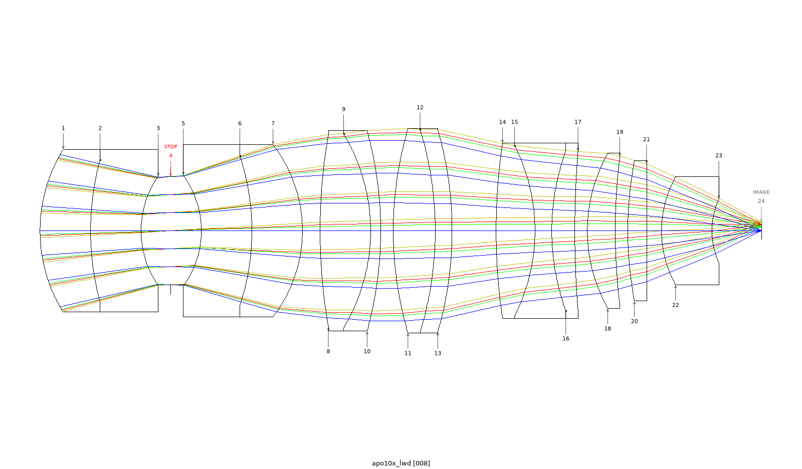

# optivibe-mcp

optivibe-mcp is an **experimental** MCP server that provides tooling for a coding
agent — such as Claude Code — to interface with Zemax OpticStudio.



*One unattended run: a 60× objective reworked into a 10× / NA 0.45 apochromat, polychromatic Strehl ≥ 0.935 at
every field point. [How it was done and measured](demos/walk-in-10x/README.md).*

It exposes OpticStudio operations as typed MCP tools: loading designs, editing lens
data, running analyses, optimization, and tolerancing, driven through the ZOS-API so
the agent doesn't have to write raw API code. Alongside the tools is a reference
layer the agent can query — operand and glass lookups, and full-text search over the
OpticStudio manual.

## What's in it

- **Tools** (`optivibe-harness`) — more than 80 typed tools that drive OpticStudio over
  the ZOS-API. Each returns a uniform result envelope rather than raising, so the
  agent checks a read-back value instead of assuming a call succeeded. Beyond
  spherical surfaces it authors aspheres, coordinate breaks, fold mirrors,
  diffraction gratings, and gradient-index media. For a settled lens it can also show which
  elements carry the colour and field-curvature terms and trial glass swaps against a control
  (see [Glass tools](#glass-tools)).
- **Reference layer** (`optivibe-reference`) — operand and glass lookups plus manual
  search, to help ground the agent's choices. Engine-free and license-free; its data
  is built locally (see [Build the reference data](#build-the-reference-data)).

The project ships **code only**. No vendor data (glass catalog, manual text, operand
descriptions) is included — you generate it from your own licensed OpticStudio
install.

## Demos

Each demo ships its brief, the agent's stage log, the starting lens and the result lens, with a
script that re-measures them: see [demos/](demos/README.md).

[An agent reworks a 60× objective into a 10× / NA 0.45 apochromat, unattended](demos/walk-in-10x/README.md)
One run with no human in the loop produced a 10× / NA 0.45 objective with a polychromatic Strehl ratio of 0.935 or
better at all four field points, measured afterwards by a separate script.

[A local model does the same job with OptiVibe's skills and MCP server](demos/local-model-10x/README.md)
Qwen3.8-Flash-Next on a local server, given a brief tuned for this task, met the same targets with a polychromatic
Strehl of 0.834 or better at all four field points. The page says where it trails Opus.

[An agent refines a 20× zoom, and the promotion gate holds it back](demos/zoom-20x/README.md)
One run more than halved the blur at the zoom's worst position, missed its distortion target, and the server refused
to promote the result over two thin filter plates. The headline figures reproduced on a re-read of the saved file.

[Does the agent design a better lens when it can see the drawing?](demos/vision-ab/README.md)
The same lens task, run with no human in the loop until each arm had three finished lenses: every run that used the layout
review produced a shorter lens than every run that worked from numbers alone (70–100 mm
against 140–221 mm), and every vision lens held an on-axis Strehl ratio of 0.93 or better at
all four wavelengths.

[The agent's glass step against OpticStudio's Hammer, on two microscope objectives](demos/glass-picking/README.md)
On the 10× / NA 0.45 apochromat both agent runs reached a lower merit than Hammer (by 13 % and 8 %) while changing
3 of 14 glasses to Hammer's 10, and every lens passes at every field. On the 20× / NA 0.70 objective Hammer's lens
has the lowest merit but fails on axis; both agent runs kept the on-axis target. The page lists the limits.

## Prerequisites

- **Windows.** OpticStudio and the ZOS-API .NET surface are Windows-only.
- **Zemax OpticStudio**, licensed for the ZOS-API. Developed against
  **2025 R1 (25.1.0, Premium)**; other versions are untested. Access is gated at
  first engine open on `IsValidLicenseForAPI`.
- **Python 3.11+.**
- **.NET Framework** — used automatically. The bootstrap sets
  `PYTHONNET_RUNTIME=netfx` and locates your install directory (via env override,
  registry, or a Program Files scan). No manual setup.

## Install

Clone the repository, then run one command from its root:

```powershell
powershell -ExecutionPolicy Bypass -File install.ps1
```

It creates a virtual environment in `.venv`, installs both packages, builds the reference
data from your OpticStudio install, runs the doctor, and prints the command that registers
the server with Claude Code. It opens no OpticStudio session. Options:

- `-Python <path>`: the Python 3.11+ to build the environment from, when the `python` on
  PATH is older;
- `-Probe`: also run the two operand probes, which open OpticStudio and need the ZOS-API
  licence (see [Build the reference data](#build-the-reference-data));
- `-Register`: run the `claude mcp add` command for you.

The script only runs the steps below, which you can also do by hand.

### Manual install

From `packages/optivibe-harness/`:

```bash
pip install -e ../optivibe-reference   # reference layer first
pip install -e .                        # then the harness
```

Install the reference package first — the harness loads it in-process, and without
it the reference and lookup tools won't be available.

The `[manual]` extra (PyMuPDF) reads your OpticStudio manual PDF. It is needed for
**both** manual search **and** the operand/tolerance description enrichment (the
build extracts verbatim descriptions from the PDF). Without it, the operand and
tolerance catalogs build **synonyms-only** (grounding still works — every entry is
searchable by its synonyms — but carries no manual descriptions). To get the full
enriched build, install it:

```bash
pip install -e "../optivibe-reference[manual]"
```

A per-package `environment.yml` (Python 3.11) is provided if you prefer conda.

Then check the install:

```bash
python -m optivibe_doctor
```

It checks the interpreter, the two packages, their dependencies, the reference data and your
OpticStudio install directory, and prints one line per check with a remedy for anything that is
wrong. It opens no OpticStudio session unless you ask: `--engine` also opens one and proves the
ZOS-API licence, and `--boot` starts the real server once. On a fresh install the reference-data
checks read `WARN` until you [build the reference data](#build-the-reference-data), and the
exit code is 1 while any check warns.

## Register with Claude Code

```bash
claude mcp add optivibe -- /path/to/python -m optivibe_harness
```

`/path/to/python` is the interpreter of the environment you installed into — pointing it at
a different Python is a common cause of silent failures. You can find it with:

```bash
python -c "import sys; print(sys.executable)"
```

The equivalent JSON configuration:

```json
{ "command": "/path/to/python", "args": ["-m", "optivibe_harness"] }
```

## Glass tools

Once the optimizer has settled a lens, two tools help with the glass step. `explain_glass_swaps`
is read-only: it lists which glass elements carry the colour and Petzval terms. `trial_glass_swaps`
tries up to four swap sets, each re-optimized beside an unchanged control, and judges them on
measured image quality; it edits the open lens while it runs and restores it at the end.
`substitute_glass` makes one swap and leaves it in place. The `design-glass-matching` skill runs
this step.

To have Claude Code ask you before either tool that edits the lens runs, add an `ask` rule to your
settings (for example `.claude/settings.json`):

```json
{
  "permissions": {
    "ask": ["mcp__optivibe__trial_glass_swaps", "mcp__optivibe__substitute_glass"]
  }
}
```

An `ask` rule takes precedence over an `allow` rule and still asks under `bypassPermissions`. In a
headless run (`claude -p`) or in `dontAsk` mode there is no one to ask, so a matching call is
denied.

## Build the reference data

The reference layer's data is built locally from your own licensed install; nothing
vendor-derived is committed. Run it from the repository root:

```bash
python packages/optivibe-reference/scripts/build_vendor_data.py
```

This reads the glass catalog from your `.agf` files (`ZEMAX_GLASSCAT`) and, if you
point it at the manual PDF (`OPTIVIBE_MANUAL_PDF`), indexes it for search.

The operand and tolerance catalogs are built from a live probe of your install's
ZOS-API enum surface. Run the two probes **once** first (each boots a headless
OpticStudio session, reads the operand/tolerance surface, and reaps it):

```bash
python packages/optivibe-reference/scripts/probe_operands.py
python packages/optivibe-reference/scripts/probe_tolerances.py
```

If an input is missing the corresponding step is skipped: that tool (glass or
manual search, or operand/tolerance lookup) returns a typed "unavailable" result
and the rest of the server keeps working. Details and the data-source ledger are
in [PROVENANCE.md](PROVENANCE.md).

## Running it

OpticStudio is not opened at startup — the engine is launched on the first tool call
that touches a design, and it works with one design at a time. The reference and
lookup tools work with no engine running — so install, registration, the reference
build, and every lookup succeed regardless of license tier; the ZOS-API license is
checked only when the engine opens.

A note on trust: tools return a result envelope and don't raise on failure, so a call
completing is not proof it did what you intended. Check the returned value or the
optimizer's verdict rather than the absence of an error.

## Skills

The repository includes a few Claude Code skills for common tasks:

| Skill | For |
|---|---|
| `design-review` | Assess a design against a spec |
| `design-compare` | Compare designs side by side |
| `design-vision-review` | Observe a rendered layout and report what lens data does not show (advisory) |
| `design-aberration-review` | Read the ray fan and field curvature / distortion plots and report how the aberrations are balanced (advisory) |
| `optimize-loop` | Run optimization with monitoring |
| `design-glass-matching` | Choose glass for a settled lens: find the elements that carry the colour or field-curvature terms, trial swaps against a control, and keep a swap only when overall image quality improves |
| `bench-catalog` | Benchmark and rank a folder of lens designs against a target spec or each other |
| `zos-api-debug` | Troubleshoot OpticStudio connection / license errors |

## Status

Experimental, early-stage and provided as-is; expect rough edges. It has been developed
and exercised against a single OpticStudio version (2025 R1) on Windows; behavior on
other versions is unverified. Interfaces and tool coverage may change.

**Running another OpticStudio version or licence tier?** Please
[open an issue](../../issues/new/choose) with the output of `python -m optivibe_doctor --engine`,
whether it works or not. A report that it works on your version is as useful as a bug.

## Contributing & contact

Bug reports, questions, and pull requests are welcome via
[GitHub Issues](../../issues) and pull requests; see [CONTRIBUTING.md](CONTRIBUTING.md).
Please don't include any vendor-derived data (glass catalogs, manual text, operand
descriptions) in issues or PRs — see [PROVENANCE.md](PROVENANCE.md).

## Licensing & provenance

optivibe-mcp is licensed under the **Apache License 2.0** — see [LICENSE](LICENSE)
and [NOTICE](NOTICE).

It is code-only and drives your own licensed OpticStudio install at runtime; no
vendor data or SDK files are redistributed. The reference data you build locally
stays local (it is gitignored). optivibe-mcp is an independent project and is not
affiliated with or endorsed by Ansys/Zemax. See [PROVENANCE.md](PROVENANCE.md) for
the data-source and license ledger.
