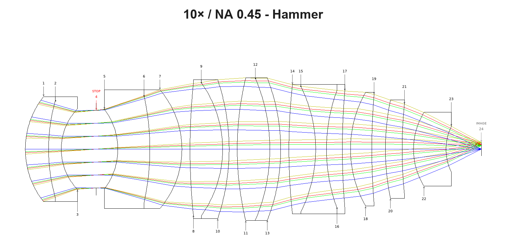
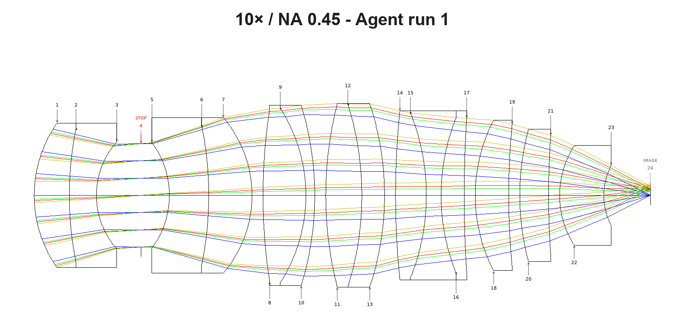
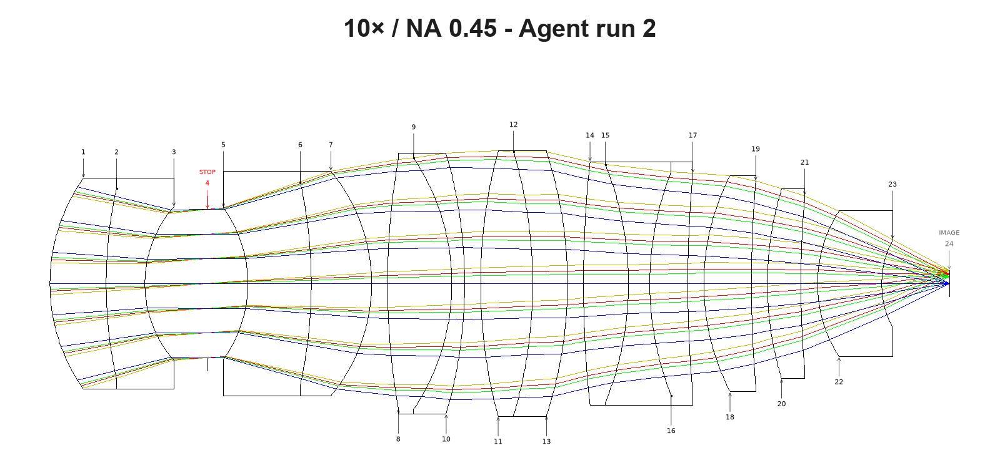
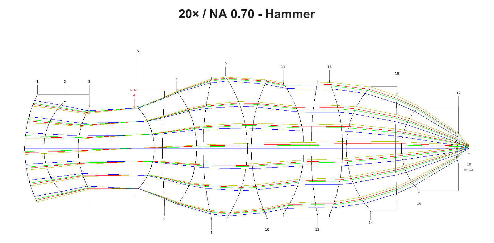
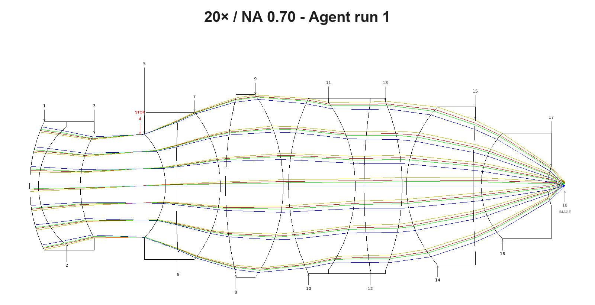
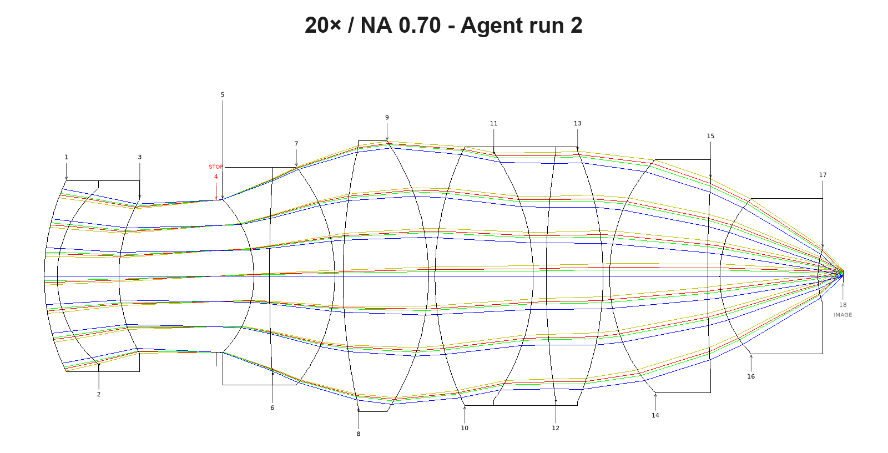

# Demo: the agent's glass step against OpticStudio's Hammer, on two microscope objectives

**OpticStudio's Hammer optimizer minimizes the merit function it is given and returns the lens with the lowest number.
The agent optimizes the same merit, but keeps a glass change only if every field that passed still passes and no
target is lost, and it explains each decision, element by element.**

| | agent | Hammer |
|---|---|---|
| how it decides | optimizes the merit; keeps a swap only if it beats a control given the same optimization and no field or target is lost | minimizes the merit function, with a substitute solve on every glass |
| what it returns | a lens, plus a per-element trail: why it looked there, the glass property it changed, each trial against its control | a lens |
| glasses changed | 10×: 3 of 14; 20×: 1 of 10 | 10×: 10 of 14; 20×: 3 of 10 |
| 10× result | merit 13 % and 8 % lower than Hammer's; run 1 better at every field, run 2 at three of four | passes at every field |
| 20× result | merit 7 % and 8 % higher; better at 0 and 0.5 field; on axis passes | lowest merit; best 0.7 and 1.0 fields; on axis fails |
| repeatability | both 10× runs chose the same three glasses; both 20× runs changed S11 | one run per lens |
| time | 32–37 min per run, end to end, report included | 60 min per lens |
| search report | lists the positions left untried and whether the search finished; all four runs said it did not | none |

**At a glance.** Both methods started from the same two microscope objectives, a 10× / NA 0.45 apochromat and a 20× /
NA 0.70 objective, with the same merit function and the same glass catalogs. On the 10× every lens passes at every
field. On the 20× no lens meets the off-axis target; both agent runs improved the three failing fields over the start
lens and kept the on-axis target.

This is an experimental feature, and the bench is small: one Hammer run and two agent runs per lens.

## How the comparison was run

Both methods started from the same two lenses, each a finished form with every glass still as the seed had it: a 10×
form-step lens from an earlier unattended run ([10x/result_10x-form-step.zmx](10x/result_10x-form-step.zmx)), and a 20×
form-step lens whose merit also holds the ray error at the pupil rim ([20x/result_20x-start.zmx](20x/result_20x-start.zmx)). Both used the same fixed merit function (294 rows on the 10×, 30 on
the 20×) and the same five glass catalogs: SCHOTT, OHARA, HIKARI, LACROIX and INFRARED.

| | agent | Hammer |
|---|---|---|
| driver | Claude Opus 5.5 driving the OptiVibe MCP server through Claude Code, Claude Sonnet 5.5 for subagents | OpticStudio's global optimizer, with a substitute solve on every glass |
| rules | the `optimize-loop` and `design-glass-matching` skills; not allowed to change the merit function | limited to the same catalogs |
| runs | two per lens, from the same starting lens and brief, unattended from start to finish | one per lens, 60 minutes each |

**At rest.** Every lens was optimized to rest before it was compared: two damped-least-squares runs in a row, each of at
least 50 cycles and each gaining under 0.5 % of the merit. Hammer's lenses were brought to rest separately. The agent
brought its own lenses to rest during each run, with one exception: the second 10× lens had a single 50-cycle
confirming run on its final glass set, which gained 0.0007 %.

**Reading the tables.** Image quality is the polychromatic RMS wavefront error, in waves, at the 0, 0.5, 0.7 and 1.0
fields. Lower is better, and the target is 0.075 waves or less at every field. Each agent cell gives the difference
from Hammer in brackets; a negative number means the agent is better. Surface numbers (S1, S2, ...) count from the tube
side.

## 10× / NA 0.45 apochromat, 2.5 mm field

| lens | merit at rest | 0 field | 0.5 field | 0.7 field | 1.0 field | glasses changed | run time |
|---|---|---|---|---|---|---|---|
| start (form step) | 0.005553 | 0.0174 | 0.0458 | 0.0454 | 0.0486 | — | — |
| Hammer | 0.003686 | 0.0168 | 0.0313 | 0.0295 | 0.0322 | 10 of 14 | 60 min |
| agent run 1 | 0.003225 (−13 %) | 0.0140 (−0.0028) | 0.0295 (−0.0018) | 0.0268 (−0.0027) | 0.0267 (−0.0055) | 3 of 14 | 33 min |
| agent run 2 | 0.003381 (−8 %) | 0.0143 (−0.0025) | 0.0317 (**+0.0004**) | 0.0285 (−0.0010) | 0.0273 (−0.0049) | 3 of 14 | 33 min |

**Every lens passes at every field.** Run 1 is better than Hammer at all four fields. Run 2 is better at three, and
0.0004 waves behind at the 0.5 field. The other targets are working distance at the rim (≥ 5.0 mm), edge and gap
floors, and total track (≤ 100 mm). All lenses meet them; the agent lenses have total tracks of 83.6 and 84.1 mm.

**Glass changes.** Both runs changed the same three glasses: S2 S-PHM52Q → N-PK52A, S16 S-FPL51Y → S-FPL53, and S1
S-BAH28 → S-NBH52. They differ only in the radii the optimizer settled on.

**What got worse.** Lateral colour at 436 nm at the edge field grew slightly in both runs (−0.24 to −0.28 µm and −0.23
to −0.29 µm). The other two colours improved. Both runs reported this.

**What carried the gain.** In both runs most of the gain came from the front cemented doublet, S1/S2. In the one-swap
screen, S2 alone lowered the merit by 25–30 %. A separate analysis of Hammer's lens found the same: Hammer's two front
glasses alone gave most of its gain, and its other eight changes were neutral or harmful. The mechanism is
partial-dispersion matching, with a flint of low partial dispersion cemented to an anomalous crown. The agent took most
of its gain at those same two front elements and added one more change, at S16.

**How the search ran.** Each run first tried one glass in every one of the 14 positions. It then ran three deeper
rounds, re-trying positions next to each kept change, and kept one more glass in each round. Both runs stopped on time,
said the search was not exhausted, and listed the positions left untried.

### Drawings

OpticStudio cross-sections of each lens at rest, with rays at each field.

**Hammer:** 10 of 14 glasses changed.

**Agent run 1:** S2 S-PHM52Q → N-PK52A, S16 S-FPL51Y → S-FPL53, S1 S-BAH28 → S-NBH52.

**Agent run 2:** the same three glasses; the radii differ.

## 20× / NA 0.70 dry objective

Values over the 0.075-wave target are marked ✗.

| lens | merit at rest | 0 field | 0.5 field | 0.7 field | 1.0 field | glasses changed | run time |
|---|---|---|---|---|---|---|---|
| start (rim-row lens) | 0.000870 | 0.0691 | 0.1025 ✗ | 0.1301 ✗ | 0.1843 ✗ | — | — |
| Hammer | 0.000802 | 0.0873 ✗ | 0.1008 ✗ | 0.1194 ✗ | 0.1691 ✗ | 3 of 10 | 60 min |
| agent run 1 | 0.000859 (+7 %) | 0.0695 (−0.0178) | 0.0986 ✗ (−0.0022) | 0.1251 ✗ (+0.0057) | 0.1807 ✗ (+0.0116) | 1 of 10 | 37 min |
| agent run 2 | 0.000864 (+8 %) | 0.0713 (−0.0160) | 0.1002 ✗ (−0.0006) | 0.1266 ✗ (+0.0072) | 0.1818 ✗ (+0.0127) | 1 of 10 | 32 min |

**On axis,** the start and both agent lenses pass; that is 1 of 4 fields each. Hammer's lens moved from 0.069 to 0.087
waves and fails, so it passes 0 of 4. **Off axis,** no lens meets the target at 0.5, 0.7 or 1.0 field. The limit is
lateral colour, which single glass changes on this form do not remove. Hammer's lens has the lowest merit and the best
0.7 and 1.0 fields. Both agent lenses are better than Hammer's at 0 and 0.5 field.

**Lowest merit or every target kept.** Hammer minimizes the merit function it is given, and its lens has the lowest
merit. The agent minimizes the same merit, but keeps a glass change only if every field that passed before still
passes. On this merit the edge field weighs ten times the on-axis field, so the lowest merit came from trading the
on-axis target for a better edge. The agent turned that trade down twice, once for the same S8 swap Hammer made.

**Glass changes.** Hammer changed S1 S-LAL59 → J-LASKH2, S8 S-FPL53 → NICF-A and S14 N-FK58 → S-FPL53. Both agent runs
found their gain at the same position, S11, the middle glass of the cemented triplet. Run 1 changed it from N-LAF21 to
N-LAF32, and run 2 to N-LASF44. Each improved the 0.5, 0.7 and 1.0 fields by 1–4 % and kept the on-axis field inside
the target, with a small loss there (0.069 to 0.070 and 0.071).

**What they turned down.** Each run optimized one other promising swap to rest and rejected it because the on-axis
field then failed: S16 S-LAH59 in run 1 and S8 NICF-A in run 2. Hammer's S8 change is the same swap.

**The search stopped early.** Neither run went back to S11's cemented partners after its keep, and both said so. They
reported "stopped with open slots", not a limit of the form.

### Drawings

OpticStudio cross-sections of each lens at rest, with rays at each field.

**Hammer:** S1 S-LAL59 → J-LASKH2, S8 S-FPL53 → NICF-A, S14 N-FK58 → S-FPL53.

**Agent run 1:** S11 N-LAF21 → N-LAF32.

**Agent run 2:** S11 N-LAF21 → N-LASF44.

## What the agent reports that Hammer does not

Hammer returns a lens. Each agent run hands back, for every element position it tried:

- the reason it looked there: primary colour, secondary colour, or a monochromatic error, read from single-wavelength
  and polychromatic wavefront at every field;
- the glass property it changed to address that reason (Abbe number, partial-dispersion anomaly, or index) and the
  candidates it ranked;
- each trial beside a control given the same optimization, at every field, labelled kept, rejected, screened (measured
  once, not yet optimized to rest) or not measured;
- the positions it left untried, and whether it calls the result a target met, a search stopped short, or a limit of
  the form.

## Limits

- **One Hammer run against two agent runs per lens.** The comparison is narrow.
- **The 10× run 2 rest evidence is thin.** Its final glass set had a single 50-cycle confirming run, which gained
  0.0007 %. Run 1 had two.
- **The 20× search ends after its first keep.** Both runs left the triplet partners of S11 untried, and each finished
  well inside the hour. A deeper second round may find more.
- **Candidate lists were capped.** Each glass search returned only the top 30–60 of up to 210 matches, and the agent
  picked from those without asking for the rest. Because the lists are sorted by the property being corrected, the
  glasses left out are the weakest candidates, but a close alternative could still be missed. Two of the four runs
  said so in their reports.
- **Hammer did better in places.** At 20× its lens has the lowest merit and the best 0.7 and 1.0 fields. At 10×, agent
  run 2 is 0.0004 waves behind it at the 0.5 field.
- **Some colour got worse.** On the 10×, lateral colour at 436 nm at the edge field grew slightly in both agent runs.
- **Not done:** tolerancing and MTF.

## Files

| | 10× | 20× |
|---|---|---|
| brief given to each agent run | [10x/brief-glass-ab.md](10x/brief-glass-ab.md) | [20x/brief-glass-ab.md](20x/brief-glass-ab.md) |
| start lens | [result_10x-form-step.zmx](10x/result_10x-form-step.zmx) | [result_20x-start.zmx](20x/result_20x-start.zmx) |
| Hammer result, at rest | [result_10x-hammer.zmx](10x/result_10x-hammer.zmx) | [result_20x-hammer.zmx](20x/result_20x-hammer.zmx) |
| agent run 1 | [result_10x-agent-run1.zmx](10x/result_10x-agent-run1.zmx) | [result_20x-agent-run1.zmx](20x/result_20x-agent-run1.zmx) |
| agent run 2 | [result_10x-agent-run2.zmx](10x/result_10x-agent-run2.zmx) | [result_20x-agent-run2.zmx](20x/result_20x-agent-run2.zmx) |
| layouts | [Hammer](10x-hammer.png), [run 1](10x-agent-run1.png), [run 2](10x-agent-run2.png) | [Hammer](20x-hammer.png), [run 1](20x-agent-run1.png), [run 2](20x-agent-run2.png) |

The lens files open in OpticStudio. The glass catalogs they name ship with it.
