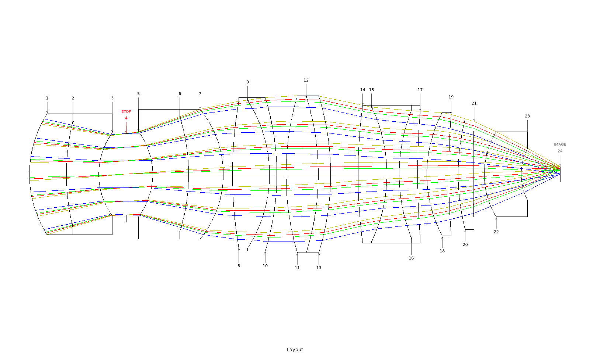
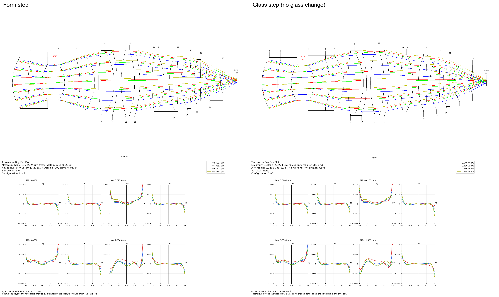
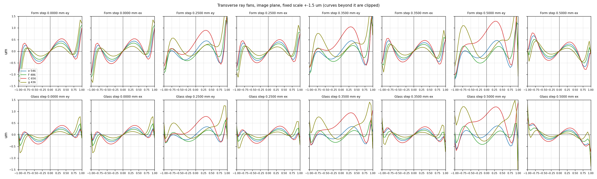

# Demo: an agent takes two microscope objectives through a form step and a glass step, unattended

**An unattended agent built the form of two microscope objectives with every glass held fixed, then ran a separate
glass step on each.** The 10× / NA 0.45 apochromat, widened from a 2 mm to a 2.5 mm field, meets every target. The
20× / NA 0.70 dry objective, rebuilt from a published patent figure, reaches the diffraction limit (Strehl ≥ 0.8) on axis only and misses its
lateral-colour target. Glass bought little. The 10× kept no glass change. On the 20×, one swap gained at every field
against its control (0.0093 waves on axis, 0.0015 at the edge), and every swap that moved colour lost somewhere. The
20× glass step started from the form-step lens after a rim-ray re-optimization done outside the agent runs; that step,
not glass, moved the edge from 0.1908 to 0.1843 waves, and the swap's edge gain was later given back. On the 20× the
limit is the form.

Each lens had two runs with their own briefs. The **form step** fixed every glass and the element count, with no
colour rows in the merit. The **glass step** started from a lens **at rest**: an optimizer run on it stops by itself
with no real gain. It compared each glass change with a **control**, the unchanged lens re-optimized the same way, on
the polychromatic RMS wavefront at every field. A colour term only points to the **carrier**, the element whose glass
contributes most to it. Claude Opus 5.5 drove the OptiVibe MCP server through Claude Code, with Claude Sonnet 5.5 for
subagents. It used the `optimize-loop`, `design-glass-matching` and `design-vision-review` skills. Surface numbers count
from the tube side.

## 10× / NA 0.45 apochromat, 2.5 mm field

**Asked:** widen the [walk-in-10x demo](../walk-in-10x/README.md) lens (byte for byte) to a 2.5 mm field at Strehl
≥ 0.80 everywhere, with working distance ≥ 5.0 mm at the rim, then try glass on what is left.

| | seed, field widened | after form step | after glass step | target |
|---|---|---|---|---|
| RMS wavefront (waves), 0 / 0.5 / 0.7 / 1.0 | 0.0174 / 0.0407 / 0.0363 / 0.1272 | 0.0174 / 0.0458 / 0.0454 / 0.0486 | 0.0189 / 0.0452 / 0.0453 / 0.0488 | ≤ 0.075 |
| Strehl, glass run's reading | — | 0.9886 / 0.9328 / 0.9284 / 0.9230 | 0.9867 / 0.9349 / 0.9293 / 0.9222 | ≥ 0.80 |
| working distance at the rim | 4.925 mm (fails) | 5.299 mm | 5.2995 mm | ≥ 5.0 mm |
| lateral colour at 1.0 field, F / C / g minus e (µm) | −0.051 / +0.167 / −0.018 | −0.173 / +0.361 / −0.234 | −0.1700 / +0.3561 / −0.2292 | no worse than loaded |

The form step fixed the edge field and the working distance. It made lateral colour worse, as expected without colour
rows. Field sag, track, edges and gaps also pass; see [runs.md](10x/runs.md).

**Glass step.** The agent tried 22 swaps, mostly on the axial-colour carriers, and kept none. Every swap it ran to rest tied
or lost, and the small changes in the last column come from one soft edge-thickness target that a layout reviewer
asked for (see [runs.md](10x/runs.md)).

**Limit.** The limit is chromatic: primary lateral colour at the edge, the g line's change of aberration with
wavelength at mid-field, and on axis the g line focusing about 0.36 µm apart from F and C.

Left, the form-step lens; right, the glass-step lens. Each half has the layout on top and the ray fans below. Both fans
are drawn at the same fixed scale, ±2.2224 µm, which is three Airy radii (Airy radius 0.7408 µm). A triangle marks each
sample beyond the scale.

## 20× / NA 0.70 dry objective, 1.5 mm working distance

The seed is US 12174359 B2, FIG. 2, rebuilt without its cover glass and with the nearest catalog glasses, so as loaded
it is not corrected.

**Asked:** a dry 20× / NA 0.70 objective with Strehl ≥ 0.80 everywhere, working distance ≥ 1.5 mm, lateral colour
≤ 0.30 µm, then a glass step with lateral-colour rows in the merit.

**Between the steps, outside the agent runs,** the form-step lens was re-optimized to rest with six extra rows that
hold the ray error at the pupil rim. An earlier glass-step run from the form-step lens itself had let that rim error
grow. The glass step below started from the rim-row lens.

| | seed | after form step | rim-row lens (glass-step start) | final | target |
|---|---|---|---|---|---|
| RMS (waves), 0 / 0.5 / 0.7 / 1.0 | 11.04 / 11.09 / 11.13 / 11.23 | 0.0598 / 0.1035 / 0.1347 / 0.1908 | 0.0691 / 0.1025 / 0.1301 / 0.1843 | 0.0528 / 0.0987 / 0.1299 / 0.1843 | ≤ 0.075 |
| Strehl | 0.0126 / 0.0058 / 0.0037 / 0.0027 | 0.902 / 0.697 / 0.549 / 0.433 | 0.836 / 0.684 / 0.566 / 0.454 | 0.897 / 0.696 / 0.555 / 0.470 (glass run's reading) | ≥ 0.80 |
| WD at rim (mm) | 1.330 | 1.613 | 1.6186 | 1.5739 | ≥ 1.5 |
| lateral colour F / C / g minus e (µm) | −0.864 / +1.428 / −1.456 | −0.342 / +0.874 / −0.244 | −0.352 / +0.881 / −0.270 | −0.347 / +0.873 / −0.252 | ≤ 0.30 |

The form run's Strehl sampling is not recorded, and its Strehl and RMS disagree; compare on RMS. The edge moved from
0.1908 to 0.1843 in the rim-row step, not in the glass step. The kept swap's 0.0015-wave edge gain was given back by a
later centre-thickness step, so the glass step's edge reads 0.1843 going in and coming out. Field sag, centre thickness
and gaps pass.

**Glass step.** One swap was kept, S16 from S-LAH55VS to S-LAH58, of 20 sets tried. The swaps that cut lateral colour
lost wavefront at one or more fields (see [runs.md](20x/runs.md)).

**Limit.** Lateral colour (C about +0.87 µm) sets the gap at 0.5 and 0.7 field. At the edge, C alone and g alone each
fail. The C-line offset at the pupil centre moved only 0.004 µm across the glass step.

This form was carried forward over a lower-RMS lens from the same seed (0.0151 / 0.0743 / 0.1029 / 0.1499 waves). That
lens met the target on axis and at 0.5 field (Strehl 0.995 / 0.807). The project's reason was that the chosen form's
main aberrations are easy to name; a blind reading of its ray fan called it stuck.

Top row: the form-step lens. Bottom row: the final glass-step lens. Both rows are drawn at the same fixed scale,
±1.5 µm; curves beyond it are clipped. The Airy radius of the glass-step lens is 0.476 µm.

## Still polishing

- **Dropped sets.** In these runs a set more than 10 % behind its control after one block was dropped, and a budget
  above 120 s per set was accepted only for a single set. On the 10× the tool dropped every set after its first
  completed call, including S8 CaF2 to FCD100 (+146 %); the agent then optimized two of the dropped swaps (S5 to
  N-KZFS5, S16 to S-FPL53) and one untried pair (S18 + S20 to N-PK51) to rest by hand, and none beat its control. Past
  winners were at or below 0.994× after one block. Since fixed: the control and each set get their own budget of up to
  600 s, with (sets + 1) × the budget at most 1800 s (four sets: 360 s each); no set is dropped after its first block,
  and from the second block a set is dropped only if it is more than 10 % behind and cannot catch up in its remaining
  budget.
- **Catalog binding.** A named glass can bind to the wrong catalog, and three 20× trial calls were refused for this.
  Since fixed: `substitute_glass` now reports the catalog it bound and warns when more than one in-use catalog
  holds the name; when a catalog is named, it refuses if another in-use catalog ahead of it holds the same name.
- **Glass data.** Seven rows carried a wrong `delta_pg_f`; for example, Q-LASFH59S read −81.0. Since fixed: such
  values now read as empty.
- **Glass choice aimed at secondary colour** is still open.
- **Process.** Neither glass-step agent used the ray-fan review.
- **One run per step.** The two 20× glass-step runs started from different lenses and kept different glasses.
- **Not done:** tolerancing and MTF.

## Files

- `10x/` and `20x/`: briefs (`brief-form.md`, `brief-glass.md`, with `{SEED}` for the starting lens), the form agent's
  `stage-log.md`, the compiled `runs.md`, form- and glass-step result `.zmx` files, and fan and layout PNGs. The
  rim-row lens the 20× glass step started from is not included.
