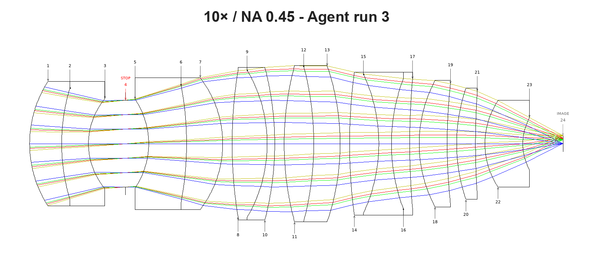

# Demo: the agent's glass step against OpticStudio's Hammer, on two microscope objectives

**OpticStudio's Hammer optimizer minimizes the merit function it is given and returns the lens with the lowest number.
The agent optimizes the same merit, but keeps a glass change only if every field that passed still passes and no
target is lost, and it explains each decision, element by element.**

| | agent | Hammer |
|---|---|---|
| how it decides | optimizes the merit; keeps a swap only if it beats a control given the same optimization and no field or target is lost | minimizes the merit function, with a substitute solve on every glass |
| what it returns | a lens, plus a per-element trail: why it looked there, the glass property it changed, each trial against its control | a lens |
| glasses changed | 10×: 5, 3 and 4 of 14; 20×: 2 and 4 of 10 | 10×: 10 of 14; 20×: 3 of 10 |
| 10× result | merit 19 %, 12 % and 13 % lower than Hammer's; all three runs better at every field | passes at every field |
| 20× result | run 2: merit 3 % lower, better at every field, but its last glass change was made by hand, outside the trial tool (before that change: 1 % lower, level at 0.7 and 1.0 field). Run 1: merit 6 % higher; better on axis, level at 0.5, worse at 0.7 and 1.0. Both pass on axis | fails on axis; better than agent run 1 at 0.7 and 1.0 field |
| repeatability | all three 10× runs changed S16 to S-FPL53 and changed S2; both 20× runs changed S16 to S-LAH58 | one run per lens |
| time | 44–54 min per run, end to end, report included | 60 min per lens |
| search report | lists the positions left untried, whether the search finished, and the search time measured by the clock; all five runs said it did not finish | none |

**At a glance.** Both methods started from the same two microscope objectives, a 10× / NA 0.45 apochromat and a 20× /
NA 0.70 objective, with the same merit function and the same glass catalogs. On the 10× every lens passes at every
field, and all three agent lenses are better than Hammer's at every field. On the 20× no lens meets the off-axis
target. Both agent lenses keep the on-axis target, which Hammer's lens loses. One agent lens is better than Hammer's at
every field; the other is behind it at the 0.7 and 1.0 fields.

This is an experimental feature, and the bench is small: one Hammer run per lens, three agent runs on the 10× and two
on the 20×.

## How the comparison was run

Both methods started from the same two lenses, each a finished form with every glass still as the seed had it: a 10×
form-step lens from an earlier unattended run ([10x/result_10x-form-step.zmx](10x/result_10x-form-step.zmx)), and a 20×
form-step lens whose merit also holds the ray error at the pupil rim ([20x/result_20x-start.zmx](20x/result_20x-start.zmx)). Both used the same fixed merit function (294 rows on the 10×, 30 on
the 20×) and the same five glass catalogs: SCHOTT, OHARA, HIKARI, LACROIX and INFRARED.

| | agent | Hammer |
|---|---|---|
| driver | Claude Opus 5.5 driving the OptiVibe MCP server through Claude Code, Claude Sonnet 5.5 for subagents | OpticStudio's global optimizer, with a substitute solve on every glass |
| rules | the `optimize-loop` and `design-glass-matching` skills; not allowed to change the merit function | limited to the same catalogs |
| clock | the glass-search clock hook, 60-minute budget (below) | 60 minutes per run |
| runs | three on the 10× and two on the 20×, from the same starting lens and brief, unattended from start to finish | one per lens |

**The glass-search clock.** The agent runs used a Claude Code hook that ships with this release. After each trial call
it tells the agent the real elapsed time and whether another trial still fits the budget. Another trial fits while the
elapsed time plus twice the longest call so far is within the budget. A re-try of a kept glass's cemented partners fits
while the elapsed time plus the longest call is within the budget. If the agent tries to stop while an owed partner re-try or another
trial still fits, the hook blocks the stop, at most twice per run. The budget is 60 minutes by default; set
`OPTIVIBE_GLASS_BUDGET_MIN` to change it, or to 0 to turn the clock off. The hook comes with a clone of the repository
(`.claude/hooks/` and `.claude/settings.json`); an install from PyPI alone does not include it.

**At rest.** Every lens was optimized to rest before it was compared. Hammer's lenses were brought to rest separately:
two damped-least-squares runs in a row, each of at least 50 cycles and each gaining under 0.5 % of the merit. Each agent
run brought its own lenses to rest. After the runs, each delivered agent lens was brought to rest again, independently:
50-cycle damped-least-squares runs, repeated until a run gained under 0.5 %. The merit and wavefront values in the
tables come from that check. It moved every agent lens by under 0.1 %; the largest move was the second 20× lens, from
0.00077539 to 0.00077475. The agent lens files below are the lenses exactly as the agent delivered them.

**Reading the tables.** Image quality is the polychromatic RMS wavefront error, in waves, at the 0, 0.5, 0.7 and 1.0
fields. Lower is better, and the target is 0.075 waves or less at every field. Each agent cell gives the difference
from Hammer in brackets; a negative number means the agent is better. Surface numbers (S1, S2, ...) count from the tube
side.

## 10× / NA 0.45 apochromat, 2.5 mm field

| lens | merit at rest | 0 field | 0.5 field | 0.7 field | 1.0 field | glasses changed | run time |
|---|---|---|---|---|---|---|---|
| start (form step) | 0.005553 | 0.0174 | 0.0458 | 0.0454 | 0.0486 | — | — |
| Hammer | 0.003686 | 0.0168 | 0.0313 | 0.0295 | 0.0322 | 10 of 14 | 60 min |
| agent run 1 | 0.002996 (−19 %) | 0.0153 (−0.0015) | 0.0250 (−0.0063) | 0.0230 (−0.0065) | 0.0266 (−0.0056) | 5 of 14 | 54 min |
| agent run 2 | 0.003251 (−12 %) | 0.0133 (−0.0035) | 0.0276 (−0.0037) | 0.0255 (−0.0040) | 0.0290 (−0.0032) | 3 of 14 | 48 min |
| agent run 3 | 0.003222 (−13 %) | 0.0158 (−0.0010) | 0.0276 (−0.0037) | 0.0248 (−0.0047) | 0.0283 (−0.0039) | 4 of 14 | 49 min |

**Every lens passes at every field.** All three agent lenses are better than Hammer's at all four fields. The other
targets are working distance at the rim (≥ 5.0 mm), edge and gap floors, and total track (≤ 100 mm). All lenses meet
them; the agent lenses have total tracks of 77.3, 82.1 and 84.5 mm.

**Glass changes.** Run 1 changed S1 S-BAH28 → J-LASF08A, S2 S-PHM52Q → S-FPM3, S14 CaF2 → S-FPL53, S15 N-KZFS11 →
N-KZFS4 and S16 S-FPL51Y → S-FPL53. Run 2 changed S2 S-PHM52Q → S-FPL53, S16 S-FPL51Y → S-FPL53 and S20 N-PSK58 →
S-FPL53. Run 3 changed S1 S-BAH28 → S-NBH59, S2 S-PHM52Q → N-PK52A, S16 S-FPL51Y → S-FPL53 and S18 N-PSK58 → N-PK52A.
All three changed S2 and made the same S16 change. They differ in the other positions.

**What got worse.** Each run reported its own small losses. Run 1: lateral colour at 436 nm at the edge field grew from
−0.234 to −0.242 µm, and the 436 nm Strehl at the edge dropped from 0.966 to 0.964. Run 2: the focus spread across the
four wavelengths grew from about 1.8 to 3.0 µm. Run 3: two single-wavelength Strehls dropped slightly (436 nm at the
edge, 0.966 to 0.961; 656 nm on axis, 0.999 to 0.993). None of these has a target.

**What carried the gain.** In all three runs most of the gain came from the front cemented doublet, S1/S2. Each run's
first keeps were there, and they gave 86–89 % of the run's total merit drop. In run 2's one-swap screen, S2 alone
lowered the merit by 29–36 %. A separate analysis of Hammer's lens found the same: Hammer's two front glasses alone gave
most of its gain, and its other eight changes were neutral or harmful. The mechanism is partial-dispersion matching,
with a flint of low partial dispersion cemented to an anomalous crown. The agent took most of its gain at those same
two front elements and added smaller changes further back. Run 1 said plainly that its four later keeps each gained
only about 1–4 % of the merit, which is inside the spread the optimizer produces on its own.

**How the search ran.** Each run first tried one glass in every one of the 14 positions. It then re-tried positions on
the improved lens, including the cemented partners of each kept change. Runs 2 and 3 stopped on their own, at a point
where the clock showed another trial no longer fitted. Run 1 tried to stop right after a keep, while a partner re-try was still
owed and fitted; the hook blocked the stop once. The agent ran the re-try, kept S14 → S-FPL53, and redid the final
rest, save and report. All three runs said the search was not exhausted and listed the positions left untried.

### Drawings

OpticStudio cross-sections of each lens, with rays at each field: Hammer's lens at rest, and each agent lens as
delivered.

**Hammer:** 10 of 14 glasses changed.

**Agent run 1:** S1 S-BAH28 → J-LASF08A, S2 S-PHM52Q → S-FPM3, S14 CaF2 → S-FPL53, S15 N-KZFS11 → N-KZFS4, S16
S-FPL51Y → S-FPL53.

**Agent run 2:** S2 S-PHM52Q → S-FPL53, S16 S-FPL51Y → S-FPL53, S20 N-PSK58 → S-FPL53.

**Agent run 3:** S1 S-BAH28 → S-NBH59, S2 S-PHM52Q → N-PK52A, S16 S-FPL51Y → S-FPL53, S18 N-PSK58 → N-PK52A.

## 20× / NA 0.70 dry objective

Values over the 0.075-wave target are marked ✗.

| lens | merit at rest | 0 field | 0.5 field | 0.7 field | 1.0 field | glasses changed | run time |
|---|---|---|---|---|---|---|---|
| start (rim-row lens) | 0.000870 | 0.0691 | 0.1025 ✗ | 0.1301 ✗ | 0.1843 ✗ | — | — |
| Hammer | 0.000802 | 0.0873 ✗ | 0.1008 ✗ | 0.1194 ✗ | 0.1691 ✗ | 3 of 10 | 60 min |
| agent run 1 | 0.000851 (+6 %) | 0.0706 (−0.0167) | 0.1008 ✗ (0.0000) | 0.1275 ✗ (+0.0081) | 0.1823 ✗ (+0.0132) | 2 of 10 | 44 min |
| agent run 2 † | 0.000775 (−3 %) | 0.0603 (−0.0270) | 0.0898 ✗ (−0.0110) | 0.1144 ✗ (−0.0050) | 0.1638 ✗ (−0.0053) | 4 of 10 | 49 min |

† Run 2's last glass change, S11, was made by hand, outside the trial tool, so the clock did not see it. Before that
change, as measured during the run, the lens had merit 0.000791 (1 % below Hammer's) and 0.0545 / 0.0918 ✗ / 0.1191 ✗
/ 0.1688 ✗ waves: better than Hammer's on axis and at 0.5 field, and level with it at 0.7 and 1.0 (0.0003 waves
better at each).

**On axis,** the start and both agent lenses pass; that is 1 of 4 fields each. Hammer's lens moved from 0.069 to 0.087
waves and fails, so it passes 0 of 4. **Off axis,** no lens meets the target at 0.5, 0.7 or 1.0 field. The limit is
lateral colour, which single glass changes on this form do not remove. Agent run 2 is the best lens at every field and
has the lowest merit, with the caveat above. Agent run 1 is better than Hammer's lens on axis and level at 0.5 field,
but Hammer's lens is better at 0.7 and 1.0 field and has the lower merit.

**Lower merit and every target kept.** Hammer minimizes the merit function it is given. On this merit the edge field
weighs ten times the on-axis field, so Hammer's merit gain came from trading the on-axis target for a better edge.
The agent minimizes the same merit, but keeps a glass change only if every field that passed before still passes. Run
2 shows the trade was not forced. Its first keep, S16, lowered the on-axis error from 0.069 to 0.058 waves. That margin
let it later keep two changes that had failed the on-axis target on the start lens: S2 → PBF2, and S8 → NICF-A, the
same S8 change Hammer made.

**Glass changes.** Hammer changed S1 S-LAL59 → J-LASKH2, S8 S-FPL53 → NICF-A and S14 N-FK58 → S-FPL53. Agent run 1 kept
one pair: S11 N-LAF21 → S-LAH59 with S16 S-LAH55VS → S-LAH58. It improved the 0.5, 0.7 and 1.0 fields by 1–2 % and kept
the on-axis field inside the target, with a small loss there (0.0691 to 0.0706). Agent run 2 kept four changes, in
order: S16 S-LAH55VS → S-LAH58, S2 S-NBH58 → PBF2, S8 S-FPL53 → NICF-A and S11 N-LAF21 → J-LASF09A. They improved every
field. Both runs changed S16 to S-LAH58 and both changed S11, to different glasses.

**The hand-made change.** Run 2 made its S11 change with `substitute_glass` and `optimize`, against its rested lens,
instead of through the trial tool. The trial tool had tried the same swap three times without keeping it. Because the
change was made by hand, the clock did not see it, and it is not in the run's reported search time or coverage. It
lowered the merit a further 1.9 %, from 0.000791 to 0.000775.

**What they turned down.** Most of the swaps run 1 tried pushed the on-axis field over the target, and it rejected
them, Hammer's S14 → S-FPL53 change among them. Run 2 rejected S11 → J-LASF09A on the start lens,
because after a full optimization the on-axis field rose to 0.080 waves and failed.

**What got worse.** In both runs the working distance shrank slightly (from 1.619 mm to 1.608 and 1.587 mm) and still
passes. Run 1's lateral colour grew slightly at all three wavelengths, and its on-axis error grew as noted above. Run 2's
lateral colour at 436 nm grew from −0.270 to −0.286 µm; the other two colours improved. Run 2 cements a PbF2 crystal,
whose thermal expansion is high, to a glass, and its report flags that joint as a thermal-mismatch risk to check.

**The search stopped short.** Both runs stopped on their own, at a point where the clock showed another trial no
longer fitted, and both said the search was not exhausted. Run 1 left one arm open: S11 → S-LAH58 hit its time limit and broke an air-gap floor, and the
fix would have needed a new merit row, which the brief forbids. Neither run called the result a limit of the form.

### Drawings

OpticStudio cross-sections of each lens, with rays at each field: Hammer's lens at rest, and each agent lens as
delivered.

**Hammer:** S1 S-LAL59 → J-LASKH2, S8 S-FPL53 → NICF-A, S14 N-FK58 → S-FPL53.

**Agent run 1:** S11 N-LAF21 → S-LAH59, S16 S-LAH55VS → S-LAH58.

**Agent run 2:** S16 S-LAH55VS → S-LAH58, S2 S-NBH58 → PBF2, S8 S-FPL53 → NICF-A, S11 N-LAF21 → J-LASF09A (made by
hand).

## What the agent reports that Hammer does not

Hammer returns a lens. Each agent run hands back, for every element position it tried:

- the reason it looked there: primary colour, secondary colour, or a monochromatic error, read from single-wavelength
  and polychromatic wavefront at every field;
- the glass property it changed to address that reason (Abbe number, partial-dispersion anomaly, or index) and the
  candidates it ranked;
- each trial beside a control given the same optimization, at every field, labelled kept, rejected, screened (measured
  once, not yet optimized to rest) or not measured;
- the positions it left untried, and whether it calls the result a target met, a search stopped short, or a limit of
  the form;
- the time the glass search took, measured by the clock rather than estimated.

## Limits

- **One Hammer run against three agent runs on the 10× and two on the 20×.** The comparison is narrow.
- **The run-to-run spread is wide.** The three 10× agent merits span about 8.5 %, and earlier runs on this bench have
  spread by about 15 %, so differences between agent runs of this size are not significant. On the 20× the two agent
  merits are about 10 % apart, more than run 2's 3 % lead over Hammer.
- **The best 20× lens includes a hand-made change.** Agent run 2 made its last change, S11, outside the trial tool, so
  the clock did not see it and the run's search time and coverage leave it out. Before that change the lens was still
  1 % below Hammer's merit, but only level with it at the 0.7 and 1.0 fields.
- **Hammer did better in places.** At 20× its lens beats agent run 1 at the 0.7 and 1.0 fields and in merit.
- **The clock stops the search early.** It keeps twice the longest call in reserve, so four of the five runs stopped
  with 10–16 minutes of the hour left. None of the five called its search exhausted.
- **Reported times can run short.** The runs read the clock at their last trial call, before the final rest, save and
  report, so a reported total can fall short of the real end; three of the five were 3–5 minutes short. The run times
  in the tables are wall-clock times.
- **Candidate lists were capped.** Each glass search returned only the top rows of a sorted list (in one run, 25 of 161
  flints and 25 of 64 crowns), and the agent picked from those without asking for the rest. Because the lists are
  sorted by the property being corrected, the glasses left out are the weakest candidates, but a close alternative
  could still be missed. All five runs said so in their reports.
- **Some colour got worse.** On the 10×, lateral colour at 436 nm at the edge field grew slightly in agent run 1. On
  the 20×, lateral colour grew slightly at all three wavelengths in agent run 1 and at 436 nm in agent run 2.
- **Not done:** tolerancing and MTF.

## Files

| | 10× | 20× |
|---|---|---|
| brief given to each agent run | [10x/brief-glass-ab.md](10x/brief-glass-ab.md) | [20x/brief-glass-ab.md](20x/brief-glass-ab.md) |
| start lens | [result_10x-form-step.zmx](10x/result_10x-form-step.zmx) | [result_20x-start.zmx](20x/result_20x-start.zmx) |
| Hammer result, at rest | [result_10x-hammer.zmx](10x/result_10x-hammer.zmx) | [result_20x-hammer.zmx](20x/result_20x-hammer.zmx) |
| agent run 1, as delivered | [result_10x-agent-run1.zmx](10x/result_10x-agent-run1.zmx) | [result_20x-agent-run1.zmx](20x/result_20x-agent-run1.zmx) |
| agent run 2, as delivered | [result_10x-agent-run2.zmx](10x/result_10x-agent-run2.zmx) | [result_20x-agent-run2.zmx](20x/result_20x-agent-run2.zmx) |
| agent run 3, as delivered | [result_10x-agent-run3.zmx](10x/result_10x-agent-run3.zmx) | — |
| layouts | [Hammer](10x-hammer.png), [run 1](10x-agent-run1.png), [run 2](10x-agent-run2.png), [run 3](10x-agent-run3.png) | [Hammer](20x-hammer.png), [run 1](20x-agent-run1.png), [run 2](20x-agent-run2.png) |

The lens files open in OpticStudio. The glass catalogs they name ship with it.
