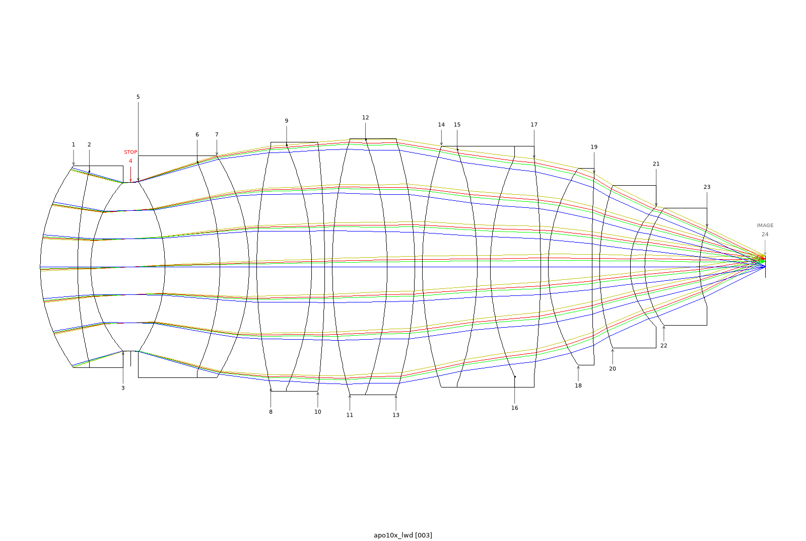
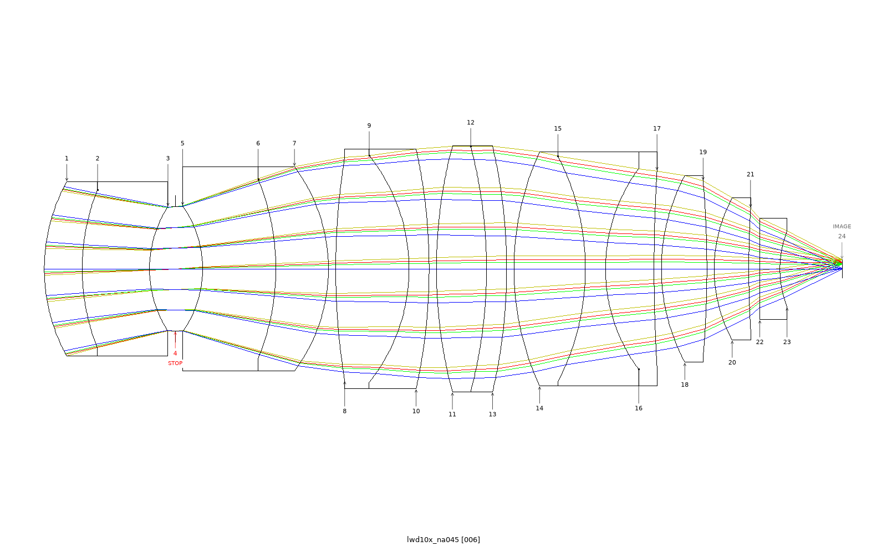
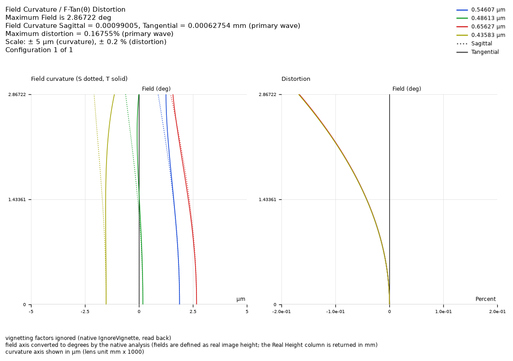

# Demo: a local model does the same job with OptiVibe's skills and MCP server

**With OptiVibe's skills and MCP server, a local model met the brief.** Qwen3.8-Flash-Next, served on the local
network, drove OpticStudio through Claude Code. It reworked the 60× apochromat into a 10× / NA 0.45 objective with a
polychromatic Strehl ratio of **0.977 / 0.942 / 0.911 / 0.834** across the field. Every field point clears the
diffraction-limited bar (Strehl ≥ 0.80), and every other target checked was met. It trails Opus, and this page
says where.

## The test

- **Task and targets:** the same as the [walk-in demo](../walk-in-10x/README.md).
- **The driver:** every model call went to the local server, including the review subagents. The run had no web
  tools.
- **Held equal with the Opus run below:**
  - the seed;
  - the targets;
  - the optimize-loop and design-vision-review skill files;
  - the measuring script.
- **Not held equal:**
  - **The brief.** The local model's brief adds a "how to get there" section: the order of work, measuring before
    adding an operand, and when to try a glass. A Claude model wrote it over three rounds, comparing earlier local
    runs with the Opus run on this task. It was tuned on this task, so this is not a cold start.
  - **One skill revision.** The local run, a day later, used a newer design-aberration-review skill.

## What it did

From its own stage log:

- **Packaging.** It scaled the seed, set NA 0.45 and switched to real ray aiming. Then it walked the length down to
  66 mm.
- **A wrong turn, caught.** Some colour operands landed on the wrong surface, and on-axis Strehl collapsed from 0.985
  to 0.668. It saw this in the read-back and rolled back to a snapshot.
- **Measure, then diagnose.** Raising the edge weights took the edge to about 0.78, where it stalled. It measured
  before acting again and concluded the loss was lateral colour, so the fix had to be a glass change.
- **Glass trials.** It kept two glass swaps and reverted one that made things worse. The kept swap on the
  second-to-last singlet took the edge from 0.79 to 0.83. Twelve of the fourteen glasses are still the seed's.
- **Reviews.** It answered the layout reviewer's two "looks tight" findings, then promoted the result itself.

## Results

Both lenses were loaded fresh and measured by the same script:

| | local model | Claude Opus 5.5, same targets |
|---|---|---|
| polychromatic Strehl, axis / 0.5 / 0.7 / 1.0 | 0.977 / 0.942 / 0.911 / 0.834 | 0.972 / 0.954 / 0.945 / 0.927 |
| focal length / NA (each run's own reading) | 20.00 mm / 0.450 | 20.00 mm / 0.450 |
| working distance, on axis | 5.99 mm | 6.79 mm |
| working distance, at the lens rim | 5.30 mm | 6.00 mm |
| field curvature (worst wavelength) | 1.2 µm | 1.2 µm |
| on-axis focus spread across 4 wavelengths | 4.2 µm | 1.4 µm |
| total track | 66.2 mm | 87.1 mm |
| clearance violations | 0 | 0 |

The rim working distance is shorter than the on-axis value because the last surface curves toward the specimen. It
was read on the engine later, as the edge thickness of the last air gap, and both lenses meet the 5 mm target. The
brief set no length target, so neither lens is packaged to a standard 45 mm parfocal objective length.

## Repeats

The final brief was launched six times:

- 4 of the 5 runs that finished passed, with edge Strehl 0.834 (this one), 0.804, 0.824 and 0.863.
- One finished run missed at 0.760.
- One run stalled.

This lens was picked for its layout. That is a pattern, not a rate.

## Where it trails Opus

- **The field edge:** 0.834 against 0.927. Across the repeats, the edge is where a run passes or fails.
- **Colour focus:** a 4.2 µm spread against 1.4 µm. The brief sets no limit on it, but it is outside the usual
  quarter-wave depth of focus (±1.35 µm, so about 2.7 µm in total) and is the clearest measured gap.
- **Hand-holding:** on the plain Opus brief, two local runs ended without a finished design. One split the seed's
  cemented groups; the other stopped mid-optimization. With "keep cemented groups cemented" added, it finished, but
  with a 150 mm lens and an edge Strehl of 0.12.
- **Form:** to a designer's eye, the Opus layout is the more natural form.

| Local model, 66 mm | Opus, same targets, 87 mm |
|---|---|
|  |  |

The horizontal offset between the wavelength curves at the bottom of the plot is the 4.2 µm focus spread. The
curvature scale is ±5 µm.

## Limits

- One task and one local model. The brief was tuned on this task.
- Not done yet: tolerancing, MTF and a glass-availability check.

## Check it yourself

This folder has the local model's [brief](brief-local-model.md) and [stage log](stage-log-local-model.md),
the Opus run's [stage log](stage-log-opus.md), and both results, `result_local-model.zmx` and
`result_opus.zmx`. The Opus run used the [walk-in brief](../walk-in-10x/brief.md). The starting lens and
a script that re-measures any lens file are in [demos/](../README.md), which also says where the
stage logs' own figures differ from this page.
