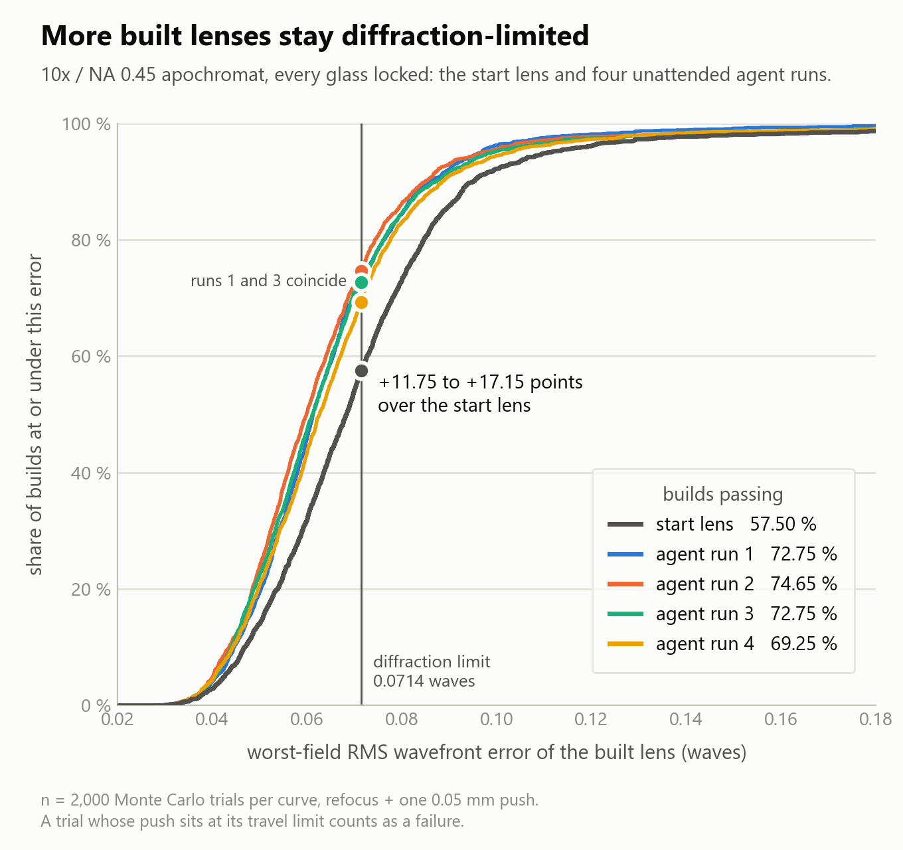

# Demo: desensitizing a finished 10x objective so more built lenses pass

**An agent took a finished 10x / NA 0.45 microscope apochromat, every glass locked, and made it less sensitive to
manufacturing errors. The share of builds that are diffraction-limited at every field rose from 57.50 % to 72.75 %,
74.65 %, 72.75 % and 69.25 % in four unattended runs (2000-trial Monte Carlo per lens, refocus plus one 0.05 mm push
of the cemented triplet). The cost was nominal wavefront, up to 0.0034 waves worse at the edge of the field, and
thicker glass: the thickest element grew from 6.005 mm to as much as 6.49 mm, against a 6.5 mm ceiling.**

| 10x / NA 0.45 apochromat | start lens | agent, 4 runs |
|---|---|---|
| builds diffraction-limited at every field (yield) | 57.50 % | 72.75 %, 74.65 %, 72.75 %, 69.25 % (mean 72.35 %) |
| builds worse than twice the limit (tail) | 2.25 % | 1.05 %, 1.45 %, 1.60 %, 1.55 % |
| P90 of the worst-field wavefront | 0.0951 waves | 0.0859, 0.0844, 0.0871, 0.0885 waves |
| full-field nominal wavefront | 0.0283 waves | 0.0314, 0.0317, 0.0313, 0.0290 waves (worse) |
| thickest element | 6.005 mm | 6.450, 6.490, 6.490, 6.247 mm (ceiling 6.5) |
| what changed | — | angle-of-incidence ceilings and thickness and gap moves inside set bounds; no glass changed |
| run time | — | 104.8, 81.8, 103.1, 85.8 min, of about 150 |

*Diffraction-limited at every field: polychromatic RMS wavefront at or under 0.0714 waves on axis and at 0.5, 0.7 and
1.0 of the field, in a simulated build perturbed within the tolerance budget, refocused, and with one group pushed
sideways by up to 0.05 mm. A build whose push sits at its travel limit counts as a failure.*

A small bench: four runs on one lens, each judged once. See [Limits](#limits).

## The setup

**The lens.** A 10x / NA 0.45 microscope apochromat, EFL 20.0012 mm, working distance 3.1212 mm, track 82.993 mm,
25 surfaces and 14 glass elements: four cemented doublets, one cemented triplet (S14-17) and three singlets. Nominal
polychromatic RMS wavefront 0.0126, 0.0156, 0.0147 and 0.0283 waves on axis and at 0.5, 0.7 and 1.0 of the field.

**The tolerance budget.** A generic high-precision grade: element decenter 0.010 mm and element tilt 0.0167°, plus
radius (as fringes), thickness, index, Abbe number, surface irregularity and surface tilt.

**The as-built rule.** Each simulated build is perturbed within the budget and refocused, and the cemented triplet
G14-17 is pushed sideways by up to 0.05 mm to rescue it. The **yield** is the share of builds at or under 0.0714
waves at all four fields; a push at its travel limit counts as a failure. The **tail** is the share worse than 0.143
waves.

**The brief.** Reach 90 % yield if possible, working for about 2 h 30 min, under these rules:

- Keep the element count, every glass, EFL, NA, working distance and clearances.
- Add no image-quality rows to the merit, and use local optimization only.
- Keep every glass centre thickness at or under 6.5 mm.
- Keep the nominal wavefront at or under 0.035 waves at every field.
- Treat length as a cost, never the lever. The track is 83.0 mm on the start lens; a change that grows it is
  compressed back before it counts, and the track is reported with its change.

The brief named the push group (G14-17) and gave the start lens's 57.5 % as the BEFORE figure. So the agent did not
run the procedure's push-picking step and ran no Monte Carlo with the push: no 2000-trial judge and no closing run.
Its own measurements of the build spread were the refocus-only yield reads described below.

**The judge.** After each run, a 2000-trial Monte Carlo of the lens exactly as delivered, with no further
optimization, on a separate merit that reads the worst of the four fields. The judge scores the push candidates on
each lens itself; on every delivered lens it ranked G14-17 first and pushed that group, and no group was forced. The
2000-trial Monte Carlo took 2080 to 4788 s per delivered lens. The standard error of a 2000-trial yield near 72 % is about 1.0 point.

**The agent.** Claude Opus 5.5 driving OpticStudio through the OptiVibe MCP server, from Claude Code run headless
(Claude Sonnet 5.5 for subagents). It follows a written procedure, the `design-tolerance-desensitize` skill, as
it ships minus one later sentence on per-field thresholds. Each run started from the same lens and ran unattended
until the agent stopped it.

## What the agent does

The lens already meets its nominal spec. This last finishing step makes more of the built lenses meet it too, by
spending some of the nominal margin.

  

**In short: four moves, repeated.**

- **The hotspot.** The agent wiggles every surface and element by its tolerance, one at a time, and finds the part that
  degrades the image most: the hotspot.
- **The cause and one lever.** It asks why that part is touchy (light meeting a surface at a steep angle, for example)
  and makes one change aimed at that cause. The optimizer reshapes the lens around it.
- **A cheap screen.** It re-reads the nominal at every field, the thicknesses, the track and the sensitivity. A change
  that spends the edge field's margin, or breaks a ceiling, is out before any yield is measured.
- **A worst-field check.** It simulates 1000 builds per field, twice, for the candidate and for the last kept lens,
  and compares the two field by field. A build passes only when every field passes, so the worst field decides.

**One round, from run 1.** The hotspot was the tilt of S13. The agent capped the angle of incidence on S13 at 11.5°.
The sensitivity RSS fell from 0.1605 to 0.1319, and the check's headline (the lowest per-field pass rate, at
field 4) went from 0.141 to 0.173: a difference of +0.032 with a standard error of 0.010. That change was kept.

**The procedure, step by step.**

1. **Keep the judge apart.** The optimizer works on the design's own merit, plus the rows the agent adds. The judge
   merit is used only for measuring.
2. **Set the ceilings before freeing a thickness or gap.** They stop the lens from buying less sensitivity by
   growing: every glass centre thickness at or under 6.5 mm and the
   track at about 83.0 mm. A candidate whose nominal is above 0.035 waves at any field is out.
3. **Find the hotspots.** A sensitivity run (seconds) perturbs each tolerance on its own. The tool assigns every row
   to an element, a cemented group or an air gap, adds each bucket in quadrature and ranks them. The ranking is
   refocus-only: it says where to look, and the agent supplies why.
4. **One lever per round, chosen by cause.** Two levers were in play: an angle-of-incidence ceiling on the hotspot's
   surface (first at about 0.8 times the current angle), and moving glass thicknesses and air gaps inside their
   ceilings to win back the nominal a ceiling cost. The agent adds a constraint row and lets the optimizer find the
   shape; it does not set a radius by hand.
5. **Screen.** Optimize to rest, then read the nominal at every field, the clearances, the track and the sensitivity
   again. A lever is worth a yield read when the RSS falls by more than a control optimize (no lever) moves it, and
   the worst field's nominal has not risen to pay for it.
6. **Look at the layout.** The procedure has a reviewer subagent read the saved candidate's layout drawing before
   each yield read. Its findings are advice; the agent answers each one.
7. **Confirm with a paired per-field yield read.** The tolerance tool (`mode="quick_yield"`) runs 1000 simulated
   builds per field, twice, with refocus only, at a 0.0714-wave threshold, on the parent (the last kept lens) and
   then on the candidate. It returns the candidate-minus-parent pass rate at each field with a standard error.
   - **Keep** when the worst field's gain is positive and resolved, no field is resolved worse, and the worst
     field's P90 is not resolved higher.
   - **Not confirmed** is anything else. The agent may screen on from it but does not make it the parent.
   - **A resolved loss** reloads the parent.

   This read does not include the push. Its headline is the LOWEST of the per-field pass rates, each field drawn on
   its own: an upper bound on the share of builds that pass at every field at once, not comparable with the judge's
   yield. It is only compared candidate against parent.
8. **Loop, then report.** After a keep, find the hotspots again. Stop when every hotspot's levers have been tried or
   the time is spent, and report every round with its decision.

## What the four runs did

**The same in all four runs.**

- The top hotspot of the start lens was E12-13, the flint element between S12 and S13 (a 17.0 % share of the
  sensitivity, RSS 0.1605). Each run's first keep was an 11.5° angle-of-incidence ceiling on S13. Runs 2 and 4 freed
  the thicknesses and gaps in the same round.
- Later keeps were a tighter S13 ceiling, a ceiling on S10, ceilings on other steep surfaces and thickness moves.
  Floors on thin elements, added after the layout reviewer flagged them, were kept only in run 2; they were rejected
  in run 1 and not confirmed in run 3.
- No run kept a ceiling on the front surface, S1. Most were screened out because they spent the edge field's margin:
  the edge nominal rose to 0.0564 waves in run 1 and 0.061 waves in run 4, against the 0.035 cap. Ceilings on S5 were
  turned down too, mostly for the same reason.
- No glass changed, and every delivered lens has 0 clearance violations.

**Per run.**

| run | keeps / yield reads | sensitivity RSS delivered | why it stopped (the agent's words, shortened) |
|---|---|---|---|
| 1 | 4 / 13 | 0.1056 | the levers were exhausted |
| 2 | 4 / 7 | 0.1016 | the angle lever had been tried on every hotspot surface (a check of its log found angle ceilings untried on ten surfaces) |
| 3 | 3 / 10 | 0.0994 | no remaining screen passed the edge-first test |
| 4 | 2 / 7 | 0.1164 | the read's standard error at field 4 (about 0.022) put a resolved gain out of reach |

The yield-read counts include each run's read of the start lens, and in run 1 a second read of a parent. The start
lens's sensitivity RSS was 0.1605.

## Results in detail

All rows are 2000-trial judges with refocus plus a 0.05 mm push of G14-17. P90, P99, mean and median are of the
worst-field RMS wavefront in waves.

| lens | yield | change | tail (> 0.143) | P90 | mean | median | P99 | trials at push limit | run time |
|---|---|---|---|---|---|---|---|---|---|
| start | 57.50 % | — | 2.25 % | 0.0951 | 0.0722 | 0.0683 | 0.196 | 2 | — |
| agent run 1 | 72.75 % | +15.25 | 1.05 % | 0.0859 | 0.0648 | 0.0613 | 0.145 | 5 | 104.8 min |
| agent run 2 | 74.65 % | +17.15 | 1.45 % | 0.0844 | 0.0638 | 0.0599 | 0.169 | 14 | 81.8 min |
| agent run 3 | 72.75 % | +15.25 | 1.60 % | 0.0871 | 0.0651 | 0.0611 | 0.163 | 10 | 103.1 min |
| agent run 4 | 69.25 % | +11.75 | 1.55 % | 0.0885 | 0.0667 | 0.0626 | 0.179 | 8 | 85.8 min |

| nominal RMS wavefront (waves) | axis | 0.5 field | 0.7 field | 1.0 field | track (mm) | thickest element (mm) |
|---|---|---|---|---|---|---|
| start | 0.0126 | 0.0156 | 0.0147 | 0.0283 | 82.993 | 6.005 |
| agent run 1 | 0.0132 | 0.0179 | 0.0177 | 0.0314 | 82.656 | 6.450 |
| agent run 2 | 0.0136 | 0.0169 | 0.0177 | 0.0317 | 82.994 | 6.490 |
| agent run 3 | 0.0133 | 0.0168 | 0.0167 | 0.0313 | 82.968 | 6.490 |
| agent run 4 | 0.0122 | 0.0172 | 0.0164 | 0.0290 | 82.927 | 6.247 |

- **Yield.** Every run gained, by 11.75 to 17.15 points, against a standard error of about 1 point per judge. The four
  runs spread over 5.4 points: runs 1 and 3 tie, run 2 is about 2 points higher and run 4 about 3.5 points lower. The
  run-to-run standard deviation is 2.25 points.
- **Tail and spread.** The tail fell from 2.25 % to 1.05-1.60 %. The P90 fell from 0.0951 to 0.0844-0.0885 waves, and
  the mean and median are lower in every run.
- **Nominal.** Every field stays far inside 0.0714 waves and under the 0.035 cap; the worst is 0.0317.
- **Form.** The track is 82.656 to 82.994 mm against the start's 82.993 mm (run 2's is 0.00003 mm longer, the others
  shorter). Every element is under 6.5 mm, EFL stays at 20.0012-20.0013 mm, the working distance is no shorter, and
  the clearances hold.
- **Levers.** Only angle-of-incidence ceilings and bounded thickness and gap moves: no image-quality rows added (the
  design's own merit rows were kept) and no glass change.
- **Time.** 81.8 to 104.8 min unattended, inside the 150 min budget.

## Limits

- **Small bench.** Four runs on one lens and one budget, each delivered lens judged once. The standard error of each
  judge is about 1.0 point; the run-to-run standard deviation is 2.25 points.
- **What got worse.**
  - The nominal is worse at every field in runs 1-3. Run 4 is worse at three fields and slightly better on axis
    (0.0126 to 0.0122). The largest rise is +0.0034 waves at the edge, in run 2.
  - The thickest element grew from 6.005 mm to 6.247-6.490 mm; two runs end within 0.01 mm of the 6.5 mm ceiling.
  - The thin flint elements got thinner. S15 went from 2.000 to 1.700 mm in run 2 and to 1.190 mm in runs 3 and 4;
    S12 went from 2.000 to 1.700, 1.271 and 1.225 mm in runs 2, 3 and 4.
  - "Form kept" means inside the brief's ceilings, not unchanged.
- **The 90 % target was not reached.** The best run gave 74.65 %.
- **Every run stopped early**, at 81.8 to 104.8 of about 150 min, although the brief said to stop only when the time
  was spent. The best-judged run was the shortest.
  - Run 4 stopped at about 85 min, citing the read's standard error at field 4 (about 0.022).
  - Run 3 stopped at about 102 min by its own clock (103.1 min wall). Its report lists some untried hotspots, but not
    every surface it never gave a ceiling.
- **The in-loop read is refocus-only** and does not see the push. Trials at the push limit rose from 2 of 2000 on the
  start lens to 5, 14, 10 and 8. The read's headline is not the as-built yield.
- **The read rests on two repeats, and it turned down a lens the judge scored higher.** A candidate that run 4 left unconfirmed
  (field 4 +0.012, standard error 0.022) was judged afterwards at 73.50 %, against 69.25 % for the lens run 4
  delivered: +4.25 points, about 3 standard errors of the difference.
- **Slow reads.** Each yield read, paired or not, took 271 to 287 s. All of a run's reads together took 57.4, 39.9,
  44.9 and 38.1 % of runs 1-4's run time.
- **The glasses were locked.**
- **Not measured.**
  - The push-picking step and the closing Monte Carlo of the skill: the brief named the push and turned the closing
    run off.
  - The skill's per-field threshold option (one threshold per field); this lens uses one threshold for all four.
  - How much of each hotspot the push absorbs.
  - Other push groups.
  - A second lens or a second budget.
  - Whether the gains come from the yield read or from the screens before it.
  - Repeat judges of the same lens.

## How we got here

Earlier versions of the procedure were tried on this same lens; this page shows the version that
ships.

## Compared with the 0.2.2 procedure

For release 0.2.2 this page showed three runs of the earlier version of the procedure on the same start lens. The judge
is the same one: a 2000-trial Monte Carlo of each delivered lens, with refocus plus a 0.05 mm push of G14-17, the same
tolerance budget, and push-limit trials counted as failures. Here are the two sets side by side. To keep the run
numbers apart from the rest of this page, the earlier runs are called "0.2.2 run 1-3".

| 10x / NA 0.45 apochromat, start lens 57.50 % | 0.2.2 procedure, 3 runs | 0.2.3 procedure, 4 runs |
|---|---|---|
| judged yield (builds diffraction-limited at every field) | 63.65, 65.05, 63.90 % (mean 64.20 %) | 72.75, 74.65, 72.75, 69.25 % (mean 72.35 %) |
| gain over the start lens | +6.15, +7.55, +6.40 points | +15.25, +17.15, +15.25, +11.75 points |
| tail (> 0.143 waves; start 2.25 %) | 1.35, 1.60, 1.05 % | 1.05, 1.45, 1.60, 1.55 % |
| P90 of the worst-field wavefront (start 0.0951 waves) | 0.0917, 0.0919, 0.0912 waves | 0.0859, 0.0844, 0.0871, 0.0885 waves |
| full-field nominal wavefront (start 0.0283 waves) | 0.0299, 0.0301, 0.0301 waves | 0.0314, 0.0317, 0.0313, 0.0290 waves |
| track (start 82.993 mm) | 82.993 mm in every run (unchanged) | 82.656, 82.994, 82.968, 82.927 mm |
| thickest element (start 6.005 mm) | 6.005 mm in every run (unchanged) | 6.450, 6.490, 6.490, 6.247 mm (ceiling 6.5) |
| trials at the push limit, of 2000 (start 2) | 5, 3, 5 | 5, 14, 10, 8 |
| run time, of the budget | 77.7, 62.2, 73.8 min, of about 120 | 104.8, 81.8, 103.1, 85.8 min, of about 150 |
| levers kept (keeps / in-loop checks) | one angle-of-incidence ceiling on S13 plus a working-distance hold, in every run (1/5, 1/5, 1/3) | angle-of-incidence ceilings on several surfaces and thickness and gap moves (4/13, 4/7, 3/10, 2/7) |
| in-loop check | a 200-trial Monte Carlo with the push; keep at about +10 points over the start lens, tail not higher | a paired per-field yield read, refocus only, of the candidate against the last kept lens |
| push group | picked by the agent (about 24 min per run); G14-17 every time | given by the brief (G14-17) |

**What changed between the two procedures.** The 0.2.2 procedure picked the push group itself, then confirmed each
change with a 200-trial Monte Carlo that included the push. Two such runs of one lens differ by up to about 10 points,
so it kept a change only at about 10 points over the start lens. The 0.2.3 procedure runs no Monte Carlo with the
push inside the loop. It compares each candidate with the last kept lens, field by field, using a refocus-only yield
read (1000 simulated builds per field, twice) with a standard error. It screens every candidate for nominal, thickness and track before the read, and has a reviewer look
at the layout. Because each change is compared with the lens before it rather than with the start, a run can stack
several smaller keeps.

**What the numbers show.** Every 0.2.3 run was judged higher than every 0.2.2 run. The lowest 0.2.3 run (69.25 %)
is 4.20 points above the highest 0.2.2 run (65.05 %). The means are 72.35 % and 64.20 %, 8.15 points apart. The
standard error of each judge is about 1 point (0.97 to 1.08), and the run-to-run standard deviation is 0.75 points for
0.2.2 and 2.25 points for 0.2.3. The 0.2.3 runs kept 2 to 4 changes each; every 0.2.2 run kept one. The 0.2.3 runs
also lowered the P90 further. The tail is about the same in both sets.

**What this comparison cannot say.**

- **Several things changed at once.** The procedure, the brief, the time budget (about 2 h against about 2 h 30 min)
  and the push-picking step all changed together, so this is not a single-variable comparison. The 0.2.3 brief also
  named the thickness-and-gap lever, set the 6.5 mm thickness ceiling, a rule to hold the track and the 0.035-wave nominal cap,
  asked for the layout review, said to stop only when the time is spent, and gave the start yield. The 0.2.2 runs
  spent about 24 min of their time picking the push. The first 0.2.3 run used a brief one sentence shorter than the
  other three.
- **Which change bought the gain is not measured.** Nothing here separates the in-loop check from the brief, the
  screens or the extra time.
- **The 0.2.3 runs paid more.** Their full-field nominal is up to 0.0034 waves worse than the start, against up to
  0.0018 for 0.2.2. Their thickest element grew to as much as 6.49 mm; the 0.2.2 runs left every thickness and the
  track as they were, apart from holding the working distance at 3.1212 mm. They also have more trials at the push limit (5 to 14, against 3 to 5).
- **A small bench.** Three runs against four, on one lens and one budget, each delivered lens judged once.

## Files

| | `10x/` |
|---|---|
| brief given to runs 2-4 (run 1 used the previous version, one sentence shorter; see the note at its top) | [brief.md](10x/brief.md) |
| judge merit | [judge_worstfield.MF](10x/judge_worstfield.MF) |
| start lens | [result_10x-start.zmx](10x/result_10x-start.zmx) |
| agent run 1, as delivered | [result_10x-agent-run1.zmx](10x/result_10x-agent-run1.zmx) |
| agent run 2, as delivered | [result_10x-agent-run2.zmx](10x/result_10x-agent-run2.zmx) |
| agent run 3, as delivered | [result_10x-agent-run3.zmx](10x/result_10x-agent-run3.zmx) |
| agent run 4, as delivered | [result_10x-agent-run4.zmx](10x/result_10x-agent-run4.zmx) |

Run numbers on this page match the file names. The lens files open in OpticStudio.
