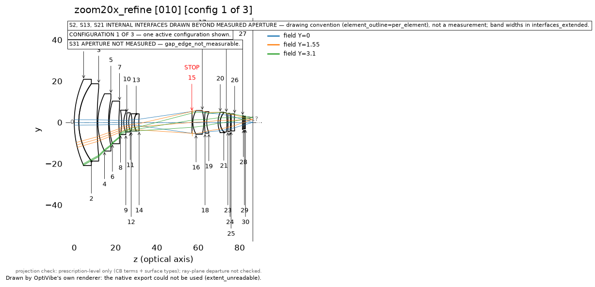
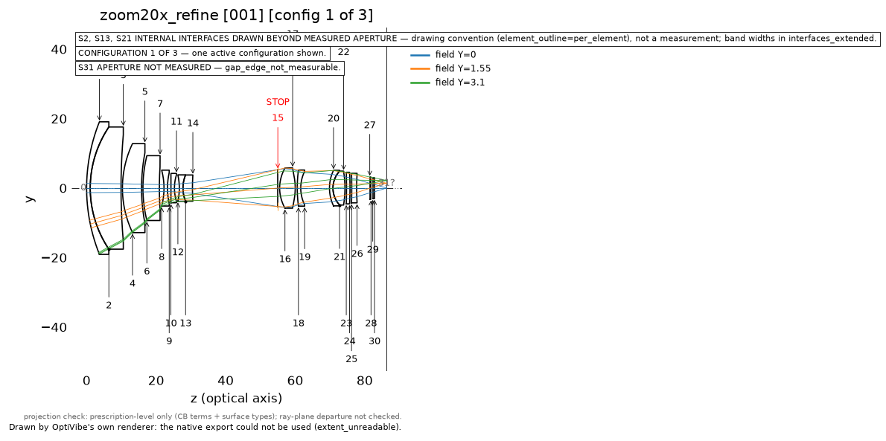
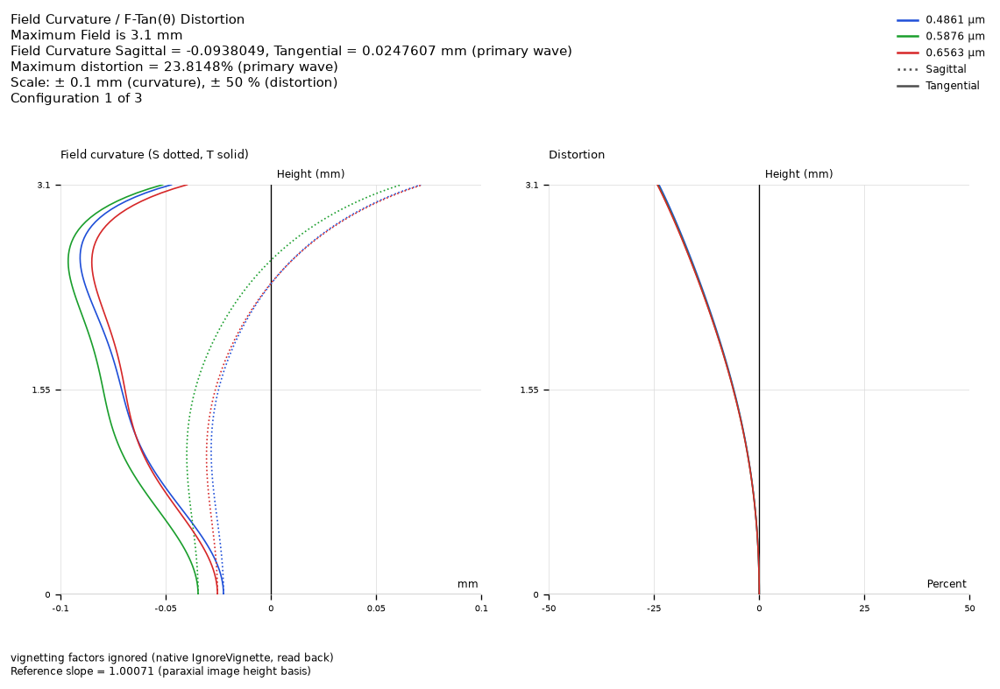

# Demo: an agent refines a 20× zoom, and the promotion gate holds it back

**One unattended run more than halved the image blur at the worst position of a finished 20× zoom.** It also missed
one target, and the server refused to promote the result:

- The tele-end RMS spot at 0.8 field went from 25.6 µm to 10.3 µm, and the spot got no worse at any other position.
- Wide distortion fell from 30.3 % to 24.0 % against a 4 % target, so that target was missed.
- `promote_best` refused the design because two filter plates in front of the sensor (0.35 and 0.50 mm thick) are
  under the brief's 1.0 mm glass floor. The agent did not force the promotion.

**The numbers are the run's own readings.** The spot, distortion, lateral-colour and focal-length figures for the
result, and the seed's spot figures, were re-read afterwards on a fresh load of the saved files and matched.

## The task

The agent got a written brief, the seed lens file and the OptiVibe skills:

- **Seed:** a 20× zoom for a 1/1.8" sensor, with these features:
  - about 4.5–90 mm, f/1.7 wide to f/3.0 tele;
  - fourteen elements and four aspheric surfaces;
  - three zoom positions;
  - two thin filter plates before the image.
- **Goal:** improve off-axis image quality at the worst zoom position without degrading the others.
- **Hold at every position:**
  - focal length ±3 %, with the image plane fixed;
  - distortion ≤ 4 % wide and ≤ 2 % tele;
  - lateral colour no worse than the seed;
  - the same element count, in real glass;
  - glass ≥ 1.0 mm and air gaps ≥ 0.3 mm;
  - local optimization only.
- **The seed already broke two of these holds:**
  - wide distortion, at 30.3 %;
  - the glass floor: one lens edge at 0.957 mm, plus the two plates.

## What the agent did

Claude Opus 5.5 drove the OptiVibe MCP server through Claude Code with the `optimize-loop`,
`design-aberration-review` and `design-vision-review` skills. The run took 72 minutes and 348 tool calls.

- **Diagnosis first.** Tele at 0.8 field was the worst position. Single-wavelength spots there were 7.5, 8.0 and
  15.1 µm, against 25.6 µm polychromatic, so the agent named lateral colour as the limit.
- **Holds before gains.** It thickened the thin element. It then capped every sampled spot, the lateral colour and
  the distortion at "no worse than the seed". It rejected a heavier tele colour weight because the on-axis spot
  doubled.
- **Glass, when weights stalled.**
  - It made four steps of glass changes. One pair was chosen after it measured that the two swaps' axial-colour
    shifts cancel.
  - Together they changed 7 of the 14 glasses and took tele lateral colour from 58.5 to 26.6 µm by the end of the
    glass stage.
- **Then the wide end.** It freed higher-order asphere terms and walked the distortion cap 30.3 → 27 → 24 %.
- **It asked for promotion,** was refused, and reported the refusal verbatim.

## Results

The run's own readings, at wide / mid / tele. The result column's first four rows reproduced on the re-read:

| | seed | result | target |
|---|---|---|---|
| RMS spot at 0.8 field (µm) | 19.80 / 7.17 / 25.55 | 10.07 / 7.01 / 10.25 | improve worst, no worse elsewhere |
| lateral colour F–C, max (µm) | 17.46 / 1.20 / 68.24 | 5.49 / 1.00 / 26.43 | no worse |
| distortion, max (%) | 30.34 / 8.44 / 0.75 | 24.01 / 4.67 / 0.67 | ≤ 4 wide, ≤ 2 tele |
| focal length (mm) | 4.500 / 20.120 / 90.000 | 4.500 / 20.120 / 90.000 | ±3 % |
| thinnest lens edge / air gap (mm) | 0.957 / 0.361 | 1.02 / 0.398 | ≥ 1.0 / ≥ 0.3 |

| Seed, wide position | Result, wide position |
|---|---|
|  |  |

The distortion plot uses a ±50 % scale. The curve reaches about 24 % barrel at the edge.

## The refusal and the miss

`promote_best` returned `promote_clearance_violation`:

> REFUSED: surface 27 glass clearance 0.35 < 1.0 mm in config 1 is manufacturably thin (+5 more); pass force=True
> WITH judgment={'reason': ...} to promote anyway, or widen the gap (check_clearance for the full audit)

**What it flagged.** The six violations are the same two N-BK7 filter plates, counted once at each zoom position.
The agent left the plates untouched. They were checked against the brief's general 1.0 mm glass floor. The brief said
to report a refusal rather than work around it, and the agent did. No design was promoted; the reported design is a
saved candidate.

**The distortion miss.** In the agent's words, 24 % "is not a measured limit. I stopped the walk on budget". This run
does not show whether 4 % is reachable on this form.

## Limits

- **One run.** The re-read covered the headline figures only; the edge, air-gap and axial-colour figures are the run's own.
- **Some things got worse.** Axial colour grew in magnitude at every position, though the seed and result values come
  from different tools. The on-axis tele wavefront is slightly worse for F and C.
- **The layout review was silent** in two rounds, with 5 of 30 labels unreadable. The agent recorded that as silence,
  not a pass.
- **Not done yet:**
  - tolerancing;
  - MTF;
  - a glass stock check;
  - a decision on whether the glass floor should apply to filter plates.
